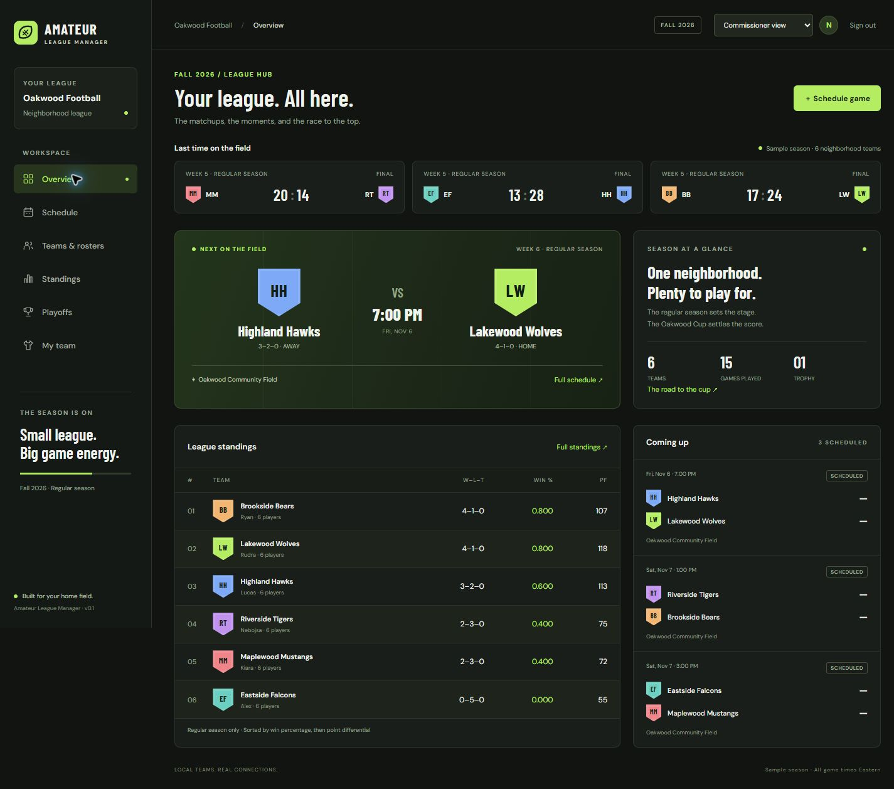

# Amateur League Manager

A browser-based home for neighborhood American football. Organize teams, rosters, game schedules, results, standings, and a postseason tournament in one place.

The interface takes inspiration from fantasy-football dashboards: dark surfaces, green highlights, matchup cards, and compact roster and standings tables. The data represents real amateur teams and game scores, not fantasy points or professional player feeds.



[View the phone layout](docs/mobile-preview.jpg)

## What works today

- Public league dashboard with recent results, the next matchup, standings, and upcoming games.
- Responsive layouts for desktop and phone browsers.
- Five developer accounts with commissioner, manager, and player views.
- Commissioner tools to create teams, add/remove roster entries, schedule games, reschedule games, mark postponements/cancellations, and record or correct scores.
- Manager tools to add/remove players on their own assigned team.
- Player view with read-only league, roster, and schedule access.
- Automatic regular-season standings calculated from final results.
- One four-team postseason cup with two semifinals and one championship. Matchups and advancement are entered manually.
- Local database persistence across restarts.

The first launch seeds a **fictional Oakwood Football league** with six teams, 36 players, 15 completed games, and three upcoming games. This is sample data, not a live sports feed. Season names and league branding are currently fixed in the interface.

## Stack

| Layer | Choice |
| --- | --- |
| Backend | Java 21, Spring Boot 4.0.9 |
| API | Spring MVC REST controllers |
| Sign-in | Spring Security, session cookies, CSRF protection |
| Data | H2 file database, Spring JDBC, SQL schema |
| Frontend | HTML, CSS, plain JavaScript |
| Build | Maven 3.9.9 wrapper |
| Tests | JUnit with a real HTTP server and an isolated in-memory database |

One application serves both the web pages and the API. There is no Node.js build, separate frontend server, Docker requirement, or external database to configure. Optional Google Fonts requests enhance the typography; system font fallbacks work offline.

## Run locally

### First-time setup on a new machine

1. Download or clone this repository. If you download a ZIP from GitHub, extract it first. Open a terminal in the extracted project folder containing `pom.xml` and `mvnw.cmd`.
2. Download a **Java 21 JDK** from the [official Eclipse Temurin download page](https://adoptium.net/temurin/releases/?version=21). Select your operating system and processor architecture. Choose **JDK**, not JRE. On a typical Intel/AMD Windows computer, choose **Windows / x64 / JDK / MSI**.
3. On Windows, run the installer. In Custom Setup, keep **Add to PATH** enabled and enable **Set JAVA_HOME**. See the [official Windows installation instructions](https://adoptium.net/installation/windows/). On macOS/Linux, choose the appropriate package and follow [Adoptium's installation instructions](https://adoptium.net/installation/).
4. Close and reopen your terminal after installing Java. On Windows, check:

```powershell
java -version
javac -version
$env:JAVA_HOME
```

Both version commands should report Java 21. `JAVA_HOME` should point to the JDK installation folder, not its `bin` subfolder. If Java is missing or an older version appears, check the installer's PATH and JAVA_HOME options and open a new terminal again.

**Java is the only development tool you must install separately.** The included Maven wrapper downloads Maven and project dependencies on its first run, so that first run needs internet access. You do not need to install Maven, Spring Boot, H2, Node.js, or Docker yourself. Git is optional if you download the project as a ZIP.

### Start the website

From the repository root:

**Windows PowerShell**

```powershell
.\mvnw.cmd spring-boot:run
```

**macOS / Linux**

```bash
sh ./mvnw spring-boot:run
```

Open **http://localhost:8080**. Stop the server with `Ctrl+C` in the terminal that started it.

Wait for the terminal to say `Started LeagueApplication` before opening the browser. Keep that terminal open while using the website. The first startup can take a few minutes while dependencies download. Opening `index.html` directly will not start the Java API.

### Shortcut on the original development machine

On the original development machine, an ignored `.tools/` directory contains a portable JDK and Maven. The helper below automatically uses those tools if a system JDK is unavailable:

```powershell
.\dev.ps1
```

That directory is not committed or required by other teammates; they can install Java and use the wrapper commands above.

If PowerShell blocks `dev.ps1` because scripts are disabled, use the standard `mvnw.cmd` command after installing Java, or use the existing portable tools directly from the repository root without changing PowerShell's execution policy:

```powershell
$env:JAVA_HOME = (Resolve-Path '.tools/jdk-21.0.13+9').Path
& '.tools/apache-maven-3.9.9/bin/mvn.cmd' '-Dmaven.repo.local=.tools/m2' spring-boot:run
```

### Port already in use

To choose another port:

```powershell
$env:PORT = '8081'
.\mvnw.cmd spring-boot:run
```

## Accounts and views

Use **Developer sign in** in the upper-right corner. The local demo password is **`neighborhood-demo`** for each account unless an environment override is configured.

| Developer | Username | Assigned team for manager/player view |
| --- | --- | --- |
| Rudra | `rudra` | Lakewood Wolves |
| Ryan | `ryan` | Brookside Bears |
| Lucas | `lucas` | Highland Hawks |
| Nebojsa | `nebojsa` | Riverside Tigers |
| Kiara | `kiara` | Maplewood Mustangs |

Use the **view selector** after signing in. It preserves the account and switches the current session between:

| View | Permissions |
| --- | --- |
| Commissioner | Create teams; manage any roster; schedule games; enter/correct results; manage cup matchups |
| Manager | View the league; manage only the assigned team's roster |
| Player | Read-only league and team access |
| Public visitor | Read-only access without signing in |

Permissions are enforced in Java, including direct API requests. Switching browser tabs does not create independent roles: tabs sharing the same session share the selected view. Refresh another open tab after switching views.

These are development accounts, not a complete public registration system. The app binds to `127.0.0.1` by default. It has not been deployed. Before hosting for real users, replace the demo credentials, add durable user/team membership management, configure HTTPS, and review public roster visibility.

Each developer's password can be overridden independently before starting the server, using `ALM_PASSWORD_RUDRA`, `ALM_PASSWORD_RYAN`, `ALM_PASSWORD_LUCAS`, `ALM_PASSWORD_NEBOJSA`, and `ALM_PASSWORD_KIARA`. Do not commit real passwords.

## Game and standings rules

- Every game has two different teams, a week, a kickoff, and a location. Times are entered and displayed as **America/New_York local time**; there is no automatic scheduling or reminder service.
- Scheduled, postponed, and cancelled games have no stored scores and do not affect standings.
- A final game requires two whole-number scores between 0 and 200. **0–0 is a valid regular-season tie**, distinct from an unplayed game.
- Only final regular-season games count toward league standings.
- Win percentage is `(wins + 0.5 × ties) / games played`. Teams with no games show `.000`.
- Standings sort by win percentage, then point differential. Exact ties use a stable team-ID order for display; this is not an official playoff seeding rule.
- Correcting a score recalculates standings; totals are derived rather than separately stored.
- The cup has at most two active semifinals with four distinct teams and one active championship. Tournament games cannot end tied.
- Both semifinal results must be final before the commissioner manually schedules the championship between their winners. Its kickoff must be after both semifinals.
- Cancel the championship before changing a semifinal winner. Cancelled cup games do not reserve a bracket slot.
- Jersey numbers range from 0 through 99 and must be unique within a roster.

## Data and project structure

```text
src/main/java/com/amateurleague/
  LeagueApplication.java    Application entry point
  SecurityConfig.java       Developer accounts and session security
  LeagueController.java     HTTP endpoints and role checks
  LeagueService.java        Validation, SQL queries, standings, cup rules
  DemoData.java             Fictional season seeded only into an empty database
src/main/resources/
  application.properties   Local server and database configuration
  schema.sql               Teams, players, and games tables
  static/
    index.html             Page shell and modal
    styles.css             Responsive dark sports interface
    app.js                 Views, forms, API calls, and role switcher
    favicon.svg            Original football mark
src/test/java/com/amateurleague/
  LeagueApplicationTests.java
data/                      Local H2 files (ignored)
.tools/                    Optional portable development tools (ignored)
```

The database is stored under `data/` relative to the working directory. Run commands from the repository root. To preserve a season, stop the app before backing up `data/`. To start over, stop the app and move `data/` to a backup location; the next launch creates and seeds a fresh database. Test runs use a separate in-memory database and do not modify the local season.

## Test and package

```powershell
.\mvnw.cmd test
.\mvnw.cmd package
java -jar target/amateur-league-manager-0.1.0-SNAPSHOT.jar
```

Use `sh ./mvnw` in place of `.\mvnw.cmd` on macOS/Linux. On the original development machine, `.\dev.ps1 test` and `.\dev.ps1 package` also work.

Tests cover public read access, CSRF enforcement, all five logins and view changes, manager/player restrictions, team creation, score updates, standings calculations, invalid game input, duplicate jersey numbers, and tournament progression. GitHub Actions runs the same Maven verification on pushes and pull requests.

## Small next steps

1. Agree on story ownership across the five developers.
2. Add team editing and configurable league/season settings.
3. Replace fixed account assignments with persisted users and memberships.
4. Add join requests if they are needed after the basic workflow is comfortable.
5. Consider reminders, score confirmation/disputes, and historical seasons later.

Automatic scheduling, SMS/email, player performance statistics, uploads, multiple leagues, and real-time updates are intentionally outside this first implementation. Refresh the page to see changes made in another browser session. Concurrent commissioner edits currently use last-write-wins; there is no edit-version conflict UI or audit log.

## Team

Rudra, Ryan, Lucas, Nebojsa, and Kiara.

## License

No project license has been selected yet. MIT is a proposed option for the team to agree on. Third-party dependencies and Maven wrapper files retain their own licenses.
