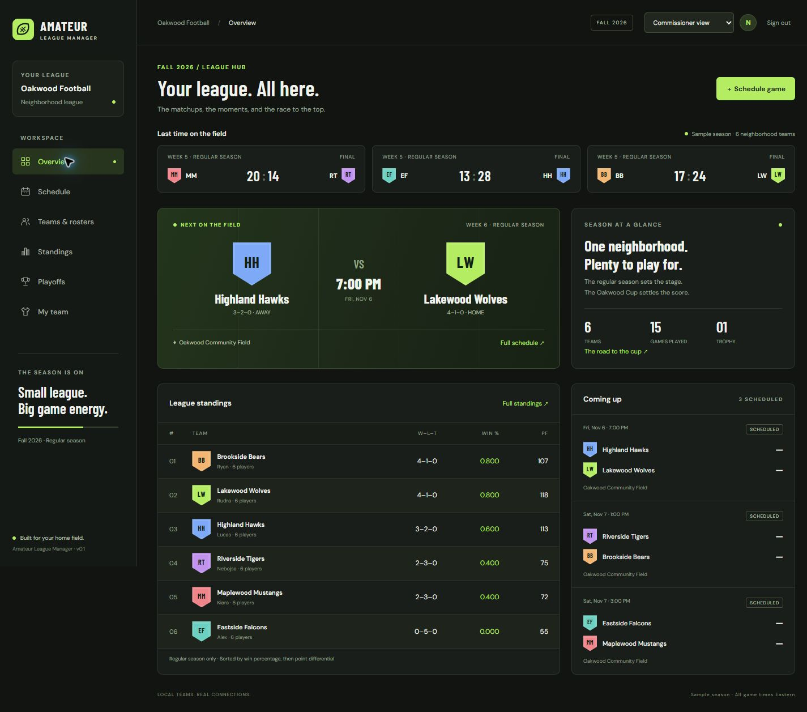

# Amateur League Manager

A browser-based home for neighborhood American football. Organize teams, rosters, game schedules, results, standings, and a postseason tournament in one place.

The interface takes inspiration from fantasy-football dashboards: dark surfaces, green highlights, matchup cards, and compact roster and standings tables. The data represents real amateur teams and game scores, not fantasy points or professional player feeds.



[View the phone layout](docs/mobile-preview.jpg)

## What works today

- Public league dashboard with recent results, the next matchup, standings, and upcoming games.
- Responsive layouts for desktop and phone browsers.
- Account sign-up with email verification, and roles that come from what each account manages or plays for.
- Commissioner tools to create teams, add/remove roster entries, schedule games, reschedule games, mark postponements/cancellations, and record or correct scores.
- Any signed-in account can create a team and becomes its manager. Managers edit their own team's name, abbreviation, and color, add/remove players, and link roster entries to accounts.
- Read-only league, roster, and schedule access for players and visitors.
- Automatic regular-season standings calculated from final results.
- One four-team postseason cup with two semifinals and one championship. Matchups and advancement are entered manually.
- Local database persistence across restarts.

The first launch seeds a **fictional Oakwood Football league** with six teams, 36 players, 15 completed games, and three upcoming games. This is sample data, not a live sports feed. Season names and league branding are currently fixed in the interface.

## Stack

| Layer | Choice |
| --- | --- |
| Backend | Java 21, Spring Boot 4.0.9 |
| API | Spring MVC REST controllers |
| Sign-in | Spring Security, session cookies, CSRF protection |
| Data | H2 file database, Spring JDBC, Flyway |
| Frontend | Svelte 5, TypeScript, Vite, Tailwind 4 |
| Build | Maven 3.9.9 wrapper (also builds the frontend) |
| Tests | JUnit with a real HTTP server and an isolated in-memory database |

One application serves both the web pages and the API. Maven downloads its own Node.js and builds the frontend into the jar, so there's no separate frontend server, Docker, or external database to set up. Optional Google Fonts requests enhance the typography; system font fallbacks work offline.

## Run locally

### First-time setup on a new machine

1. Download or clone this repository. If you download a ZIP from GitHub, extract it first. Open a terminal in the extracted project folder containing `pom.xml` and `mvnw.cmd`.
2. Download a **Java 21 JDK** from the [official Eclipse Temurin download page](https://adoptium.net/temurin/releases/?version=21). Select your operating system and processor architecture. Choose **JDK**, not JRE. On a typical Intel/AMD Windows computer, choose **Windows / x64 / JDK / MSI**.
3. On Windows, run the installer. In Custom Setup, keep **Add to PATH** enabled and enable **Set JAVA_HOME**. See the [official Windows installation instructions](https://adoptium.net/installation/windows/). On macOS/Linux, choose the appropriate package and follow [Adoptium's installation instructions](https://adoptium.net/installation/).
4. Close and reopen your terminal after installing Java. On Windows, check:

```powershell
java -version
javac -version
$env:JAVA_HOME
```

Both version commands should report Java 21. `JAVA_HOME` should point to the JDK installation folder, not its `bin` subfolder. If Java is missing or an older version appears, check the installer's PATH and JAVA_HOME options and open a new terminal again.

**Java is the only development tool you must install separately.** The included Maven wrapper downloads Maven, Node.js, and project dependencies on its first run, so that first run needs internet access. You do not need to install Maven, Spring Boot, H2, Node.js, or Docker yourself. Git is optional if you download the project as a ZIP.

### Start the website

From the repository root:

**Windows PowerShell**

```powershell
.\mvnw.cmd spring-boot:run
```

**macOS / Linux**

```bash
sh ./mvnw spring-boot:run
```

Open **http://localhost:8080**. Stop the server with `Ctrl+C` in the terminal that started it.

Wait for the terminal to say `Started LeagueApplication` before opening the browser. Keep that terminal open while using the website. The first startup can take a few minutes while dependencies download. Opening `index.html` directly will not start the Java API.

### Shortcut on the original development machine

On the original development machine, an ignored `.tools/` directory contains a portable JDK and Maven. The helper below automatically uses those tools if a system JDK is unavailable:

```powershell
.\dev.ps1
```

That directory is not committed or required by other teammates; they can install Java and use the wrapper commands above.

If PowerShell blocks `dev.ps1` because scripts are disabled, use the standard `mvnw.cmd` command after installing Java, or use the existing portable tools directly from the repository root without changing PowerShell's execution policy:

```powershell
$env:JAVA_HOME = (Resolve-Path '.tools/jdk-21.0.13+9').Path
& '.tools/apache-maven-3.9.9/bin/mvn.cmd' '-Dmaven.repo.local=.tools/m2' spring-boot:run
```

### Port already in use

To choose another port:

```powershell
$env:PORT = '8081'
.\mvnw.cmd spring-boot:run
```

### Frontend development

Start the app with the `dev` profile to get hot reload:

```powershell
.\mvnw.cmd spring-boot:run -Pdev
```

```bash
sh ./mvnw spring-boot:run -Pdev
```

The `dev` profile uses an in-memory H2 database. It is recreated from the Flyway migrations each time the app starts, so data entered during a dev session is discarded when the app stops. Runs without `-Pdev` continue to use the persistent local database under `data/`.

Then open **http://localhost:5173**. `Ctrl+C` stops both servers. Java changes still need a restart.

Frontend code is in `frontend/src/`, and the theme (colors, fonts, breakpoints) is in `frontend/src/app.css`. Before committing, run `.\mvnw.cmd -Pformat` (or `sh ./mvnw -Pformat`) to format the Java and frontend code with Prettier. CI fails on unformatted code, compiler or Error Prone warnings, type errors, ESLint errors, and any `if`/`else`/`for`/`while` without braces (formatting won't add them for you).

The build generates TypeScript types for the API from the Java code, so they never go stale. If a record field can be `null`, mark it with `@Schema(types = {"integer", "null"})` so its type allows `null`.

## Accounts and roles

Anyone can view the league without signing in. To make changes, use **Sign in** in the upper-right corner, or create an account there with a name, email, and password. New accounts confirm their email with a six-digit code. Email delivery is not built yet, so the code is printed in the server terminal.

Roles come from the account, not from a setting:

| Role | Who | Permissions |
| --- | --- | --- |
| Commissioner | Developer accounts, plus any email listed in `ALM_COMMISSIONER_EMAILS` when it signs up | Create and edit teams; manage any roster; assign team managers; schedule games; enter/correct results; resolve score disputes |
| Manager | An account that created a team (**Create team** on the Teams page), or one the commissioner assigned (**Assign manager** on a roster page) | Edit that team's details, manage its roster, link roster entries to accounts, and submit or confirm its scores |
| Player | An account linked to a roster entry (**Link account** on a roster page) | Read-only access; the team appears under **My team** |
| Public visitor | Not signed in | Read-only access |

Permissions are enforced in Java, including direct API requests.

The demo data includes five developer accounts. Each is a commissioner and manages one team. The password is **`neighborhood-demo`** unless overridden.

| Developer | Email | Manages |
| --- | --- | --- |
| Rudra | `rudra@example.com` | Lakewood Wolves |
| Ryan | `ryan@example.com` | Brookside Bears |
| Lucas | `lucas@example.com` | Highland Hawks |
| Nebojsa | `nebojsa@example.com` | Riverside Tigers |
| Kiara | `kiara@example.com` | Maplewood Mustangs |

Each developer's password can be overridden independently before starting the server, using `ALM_PASSWORD_RUDRA`, `ALM_PASSWORD_RYAN`, `ALM_PASSWORD_LUCAS`, `ALM_PASSWORD_NEBOJSA`, and `ALM_PASSWORD_KIARA`. Do not commit real passwords. Developer accounts are created on every startup, but their team assignments are only seeded with a fresh database; in an older `data/` database, assign them with **Assign manager** or move `data/` aside.

The app binds to `127.0.0.1` by default. It has not been deployed. Before hosting for real users, remove the demo accounts, add real email delivery, configure HTTPS, and review public roster visibility.

## Game and standings rules

- Every game has two different teams, a week, a kickoff, and a location. Times are entered and displayed as **America/New_York local time**; there is no automatic scheduling or reminder service.
- Scheduled, postponed, and cancelled games have no stored scores and do not affect standings.
- A final game requires two whole-number scores between 0 and 200. **0–0 is a valid regular-season tie**, distinct from an unplayed game.
- Only final regular-season games count toward league standings.
- Win percentage is `(wins + 0.5 × ties) / games played`. Teams with no games show `.000`.
- Standings sort by win percentage, then point differential. Exact ties use a stable team-ID order for display; this is not an official playoff seeding rule.
- Correcting a score recalculates standings; totals are derived rather than separately stored.
- The cup has at most two active semifinals with four distinct teams and one active championship. Tournament games cannot end tied.
- Both semifinal results must be final before the commissioner manually schedules the championship between their winners. Its kickoff must be after both semifinals.
- Cancel the championship before changing a semifinal winner. Cancelled cup games do not reserve a bracket slot.
- Jersey numbers range from 0 through 99 and must be unique within a roster.

## Data and project structure

```text
src/main/java/com/amateurleague/
  LeagueApplication.java    Application entry point
  SecurityConfig.java       Developer accounts and session security
  LeagueController.java     HTTP endpoints and role checks
  LeagueService.java        Validation, SQL queries, standings, cup rules
  DemoData.java             Fictional season seeded only into an empty database
src/main/resources/
  application.properties   Local server and database configuration
  db/migration/            Database migrations
frontend/
  src/App.svelte           Layout and page switching
  src/app.css              Theme
  src/lib/                 Pages, forms, components, API helper
src/test/java/com/amateurleague/
  LeagueApplicationTests.java
data/                      Local H2 files (ignored)
.tools/                    Optional portable development tools (ignored)
```

The database is stored under `data/` relative to the working directory. Run commands from the repository root. To preserve a season, stop the app before backing up `data/`. To start over, stop the app and move `data/` to a backup location; the next launch creates and seeds a fresh database. Test runs use a separate in-memory database and do not modify the local season.

To change the database, add a new file to `src/main/resources/db/migration/` (`V2__add_leagues.sql`, and so on) instead of editing an old one.

## Test and package

```powershell
.\mvnw.cmd test
.\mvnw.cmd package
java -jar target/amateur-league-manager-0.1.0-SNAPSHOT.jar
```

Use `sh ./mvnw` in place of `.\mvnw.cmd` on macOS/Linux. On the original development machine, `.\dev.ps1 test` and `.\dev.ps1 package` also work.

Tests cover public read access, CSRF enforcement, developer logins, roles derived from team memberships, manager/player restrictions, team creation, score updates, standings calculations, invalid game input, duplicate jersey numbers, and tournament progression. GitHub Actions runs `mvnw verify` on pushes and pull requests, which also checks formatting with Prettier and runs Checkstyle (braces), Error Prone, svelte-check, and ESLint in strict mode.

## Small next steps

1. Agree on story ownership across the five developers.
2. Add configurable league/season settings.
3. Add join requests if they are needed after the basic workflow is comfortable.
4. Add email delivery for verification codes.
5. Consider reminders and historical seasons later.

Automatic scheduling, SMS/email, player performance statistics, uploads, multiple leagues, and real-time updates are intentionally outside this first implementation. Refresh the page to see changes made in another browser session. Concurrent commissioner edits currently use last-write-wins; there is no edit-version conflict UI or audit log.

## Team

Rudra, Ryan, Lucas, Nebojsa, and Kiara.

## License

No project license has been selected yet. MIT is a proposed option for the team to agree on. Third-party dependencies and Maven wrapper files retain their own licenses.
